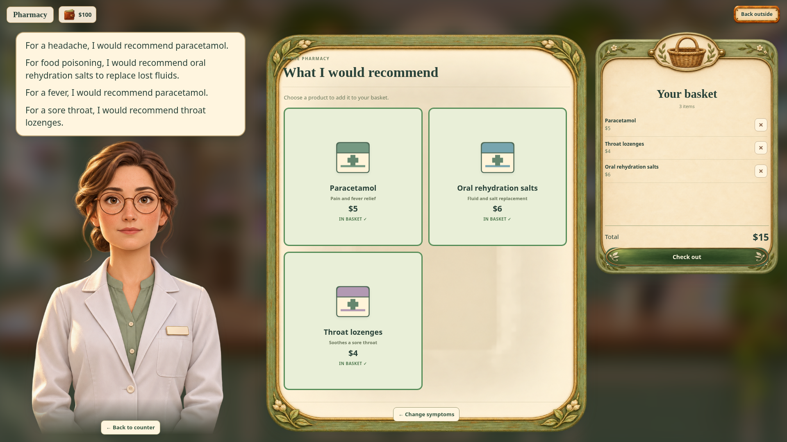

# Pharmacy shop pilot

Download **Little-Town-Pharmacy-Shop.zip** using GitHub's **Download raw file** button. Extract it, then open **Little-Town.html** in a browser. The game is fully offline.

## Try it

1. Enter the pharmacy on **Garden Street**, between the post office and supermarket, then click the chemist.
2. Choose one or more of the twelve symptom pictures. Selected pictures have a green frame; click again to unselect. **Names: on/off** toggles the English phrases.
3. Click **What would you recommend?** Read the chemist's recommendations and choose priced medicine cards.
4. Items appear in **Your basket**, with removal buttons and a live total. **Check out** spends player money and shows a receipt. Insufficient funds preserve your basket and balance.

**Back to counter** or Escape returns to the room; Escape from the room leaves. **Back outside** leaves directly. Completed spending saves with progress. The basket contains one of each chosen product; recommendations shared across symptoms are combined. The pilot uses generic symptom-relief products and fictional prices.

## Verification

Syntax/full Node tests and Chromium pharmacy, interior, money and exterior gameplay suites pass. Checks cover selection/green frames, names toggle, recommendations/deduplication, editing/totals, insufficient funds, $100 → $85 payment/reload, repeated checkout, stale actions, focus, entry/exit and independent scrolling at desktop/tablet/portrait/landscape sizes. All supplied images, maps, paths, walking and traffic logic are preserved. The archived HTML is byte-identical to the build.

[Recovery plan](../docs/IMPLEMENTATION_PLAN.md) · [Shop flow, catalog and implementation](../docs/PHARMACY_SHOP.md) · [Generated artwork prompts](../assets/ui/pharmacy/README.md)

Branch: `preview/pharmacy-shop-20261107`. Main is unchanged; previous previews remain on their earlier branches.
